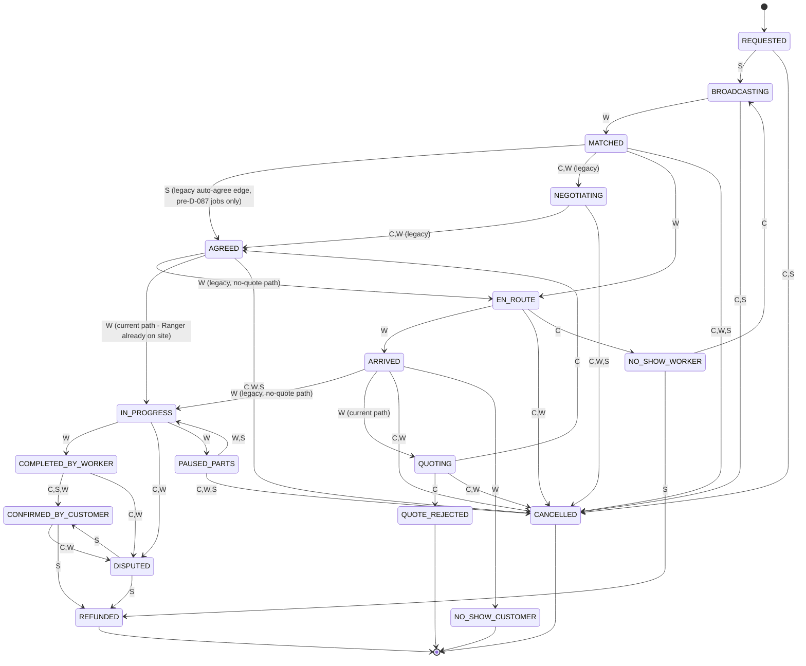

# 02 — Job Flow and Money

> Source: `apps/api/src/marketplace/job-state.ts` (the authoritative state table, read in full),
> `lifecycle.service.ts`, `fee.service.ts`, `marketplace-config.service.ts`, `quotes.service.ts`,
> `quote-builder.service.ts`. All money figures below were produced by **running the real
> `FeeService` code** (not re-derived by hand) — see the worked example section.

## The on-demand job flow, step by step

1. **Customer posts a request** (`REQUESTED`) — category, description, optional photos, address.
2. **System broadcasts it** (`BROADCASTING`) to nearby online, KYC-tier-2+ Rangers in waves —
   `broadcast_radii_m: [2000, 5000, 10000]` (2 km, then 5 km, then 10 km), `broadcast_wave_size: 5`
   Rangers per wave, `broadcast_wave_interval_seconds: 60` between waves, each offer expiring after
   `offer_ttl_seconds: 300` (5 min).
3. **A Ranger accepts** → `MATCHED`.
4. **Ranger travels** → `EN_ROUTE` (actor: Ranger). Live location is tracked
   (`location_min_interval_seconds: 4`).
5. **Ranger arrives** → `ARRIVED` (actor: Ranger), gated by an arrival geofence
   (`arrival_geofence_m: 500`) and a 6-digit arrival code (`job_code_length: 6`,
   `job_code_ttl_seconds: 900` = 15 min) plus a required selfie upload, verified in
   `lifecycle.service.ts`'s `verifyArrival`.
6. **Ranger diagnoses on site and sends a line-itemised quote** → `QUOTING` (actor: Ranger). This
   is the current default path (`quote_flow_enabled = true`); see "Flags" below for the legacy
   edge it replaces.
7. **Customer accepts or rejects the quote**:
   - Accept → `AGREED` (actor: Customer) → work starts immediately → `IN_PROGRESS` (actor:
     Ranger) — no second `EN_ROUTE` leg, since the Ranger is already on site.
   - Reject → `QUOTE_REJECTED` (terminal; a visit fee may be charged — see Money rules).
8. **Mid-job, the Ranger may pause to fetch a part** → `PAUSED_PARTS` (actor: Ranger), then resume
   → `IN_PROGRESS` (actor: Ranger or System) or the customer declines the extension →
   `CANCELLED`. Capped at `max_parts_extensions: 2` extensions and
   `max_concurrent_paused_jobs_per_worker: 2` simultaneous paused jobs per Ranger.
9. **Ranger finishes and uploads an "after" photo** → `COMPLETED_BY_WORKER` (actor: Ranger).
10. **Payment settles** (inside the same flow as step 11, see Money rules), then **confirmation**:
    - If `completion_otp_enabled` (default on) and payment was ONLINE: the Ranger enters a
      server-issued completion code the customer shares, which is what actually calls
      `confirm()`. **This is a deliberate deviation from the master prompt's literal wording**,
      which had the Ranger generate/share a code for the customer to enter — flipped because
      `confirm()` already belongs to the customer's auth path, and duplicating its settlement
      transaction for a second entry point was judged riskier than this swap (documented
      honestly in `docs/DECISIONS.md` D-089).
    - → `CONFIRMED_BY_CUSTOMER` (actor: Customer, System, or Worker).
    - A `completion_otp_auto_release_hours: 24` config value exists for an auto-release job (if
      nobody confirms within 24h and no dispute is open), but **no code was found that actually
      reads this value** — `grep -rln "completion_otp_auto_release_hours" apps/api/src` matches
      only `fee.service.ts` itself (the definition). **This is a config knob with no consumer —
      the auto-release does not actually happen today.** `docs/RUNBOOK.md`'s own "before launch"
      checklist independently flags this exact gap ("confirm the completion-code auto-release job
      described below actually exists (it does not yet)"). See `10-compliance-and-gaps.md`. A
      withheld completion code can therefore currently strand a Ranger's payout indefinitely.
11. Either party may raise a **dispute** at `IN_PROGRESS`, `COMPLETED_BY_WORKER`, or
    `CONFIRMED_BY_CUSTOMER` → `DISPUTED`, resolved by an admin to either `REFUNDED` or back to
    `CONFIRMED_BY_CUSTOMER`.
12. **No-shows**: Ranger never arrives (customer reports after `worker_no_show_minutes: 30`) →
    `NO_SHOW_WORKER`, which can re-broadcast (`BROADCASTING`) or refund; customer absent after
    arrival (Ranger reports after `customer_no_show_minutes: 15`) → `NO_SHOW_CUSTOMER`, terminal.
13. **Cancellation** is allowed by either party up to `ARRIVED` (not `QUOTING` or
    `PAUSED_PARTS` — those have their own reject endpoints that freeze a visit fee correctly
    instead; see Money rules). A customer cancelling after the Ranger has travelled
    `cancel_fee_travel_m: 1000` (1 km) or more triggers `cancellationFeeApplies: true`.

## Job state machine (Mermaid)

Full transition table, every edge labelled with who may trigger it (C = Customer, W = Worker/
Ranger, S = System). Source: `job-state.ts`'s `TRANSITIONS` object, verbatim.

Note: `AGREED:[S]` from `MATCHED`, `NEGOTIATING`'s edges, and `EN_ROUTE:[W]` from `AGREED` are
explicitly kept in the code only so a job already mid-flow under the pre-D-087 ("D-080 auto-
agree") version keeps working — the comment in `job-state.ts:28-34` states no *new* job is routed
through them. A new job today always goes `ARRIVED → QUOTING → AGREED → IN_PROGRESS`.

## Money rules (from `fee.service.ts` and `marketplace-config.service.ts`)

All values below are the `DEFAULT_FEE_SETTINGS`/`DEFAULT_SETTINGS` constants in the code — the
live values if nobody has overridden them via the admin console's `SystemConfig` table (which
caches reads for 15 seconds, `fee.service.ts:115`).

| Rule | Config key | Default |
|---|---|---|
| Platform fee | `platform_fee_bps` | 800 bps = **8%**, charged on the **labour portion only** (not parts, not the capped extra) — this is a D-087 change from the old whole-price fee |
| Platform fee floor | `platform_fee_min_paise` | ₹20 |
| Online-payment discount | `online_payment_discount_bps` | 200 bps = **2%** off the total, for paying online instead of cash |
| Cash enabled | `cash_enabled` | **false** — in-app payment only by default (D-089); flipping this one flag brings cash back everywhere, the dues ledger below stays dormant but intact until then |
| Cash dues threshold | `worker_dues_threshold_paise` | ₹500 — a Ranger's new jobs pause once unpaid cash-job platform-fee dues reach this |
| Quote ceiling multiple | `quote_ceiling_multiple_bps` | 15,000 bps = **1.5×** a line item's price-list floor, unless overridden per item/category |
| Quote "extra" line cap | `quote_extra_cap_bps` | 1,000 bps = **10% of the quote's labour total** — the one free-text/undefined line a Ranger can add |
| Visit fee bands (by distance travelled) | `visit_fee_bands` | 0 m: ₹99 · 5 km: ₹149 · 15 km: ₹199 — all three explicitly code-commented as **placeholder values** |
| Ranger's cut of a charged visit fee | `visit_fee_worker_commission_bps` | 9,000 bps = **90%** (platform keeps 10%) |
| Auto-release of earnings | `completion_otp_auto_release_hours` | **Config value only (24h) — NOT BUILT.** No code consumes this value; see the correction above |
| Parts-pause extension cap | `max_parts_extensions` | 2 per job |
| Concurrent paused jobs | `max_concurrent_paused_jobs_per_worker` | 2 |
| Cancellation-fee travel threshold | `cancel_fee_travel_m` | 1,000 m — a customer cancelling after the Ranger has travelled this far gets `cancellationFeeApplies: true` flagged (the fee itself is computed/charged downstream; the flag is set in `lifecycle.service.ts:559-561`) |
| Arrival-code wrong-try lockout | `arrival_code_max_tries` | 5 |
| Max open jobs per customer | `max_open_jobs_per_customer` | 3 simultaneously |
| Customer/Ranger no-show grace | `customer_no_show_minutes` / `worker_no_show_minutes` | 15 / 30 |

### Settlement (what `confirm()` actually does — `lifecycle.service.ts:388-525`)

- **Cash job**: the Ranger already physically holds 100% of what the customer paid, including the
  platform's fee. `confirm()` records what the customer says they paid
  (`cashConfirmedPaise`); if it doesn't match what the Ranger recorded, the payment is flagged
  `MISMATCHED` (not blocked). The platform fee owed is added to the Ranger's **dues** ledger
  (`WorkerWalletService.addDues`) — nothing is auto-deducted, it accrues until the
  `worker_dues_threshold_paise` pause kicks in.
- **Online job**: `confirm()` credits the Ranger's wallet with `servicePricePaise` (the labour
  price, net of the platform's cut which was already taken at payment capture) via
  `WorkerWalletService.creditEarning`.
- Both paths run inside one Postgres transaction with the state transition, so settlement and the
  status change can never diverge.

### Worked example — fan repair (floor ₹400, labour ₹500, parts ₹150)

Computed by instantiating the real `FeeService` class (with a stubbed Prisma that returns no
`SystemConfig` overrides, i.e. the shipped defaults) and calling its actual
`computeFeePaise`/`ceilingPaise`/`visitFeePaise` methods — not hand-derived:

| Quantity | Formula | Result |
|---|---|---|
| Platform fee on labour | `round(50000 × 800 / 10000)`, floored at 2000 | **₹40.00** (4000 paise) |
| Quote ceiling for this line | `round(40000 × 15000 / 10000)` | **₹600.00** (the Ranger may not quote labour above this for a ₹400-floor item, absent an override) |
| "Extra" line cap | `round(50000 × 1000 / 10000)` | **₹50.00** max for one undefined extra line |
| Customer's total (labour + parts) | `50000 + 15000` | **₹650.00** |
| Online-payment discount on that total | `round(65000 × 200 / 10000)` | **₹13.00** |
| Visit fee at 0 m travelled | band match | **₹99.00** |
| Visit fee at 6 km travelled | band match (≥5 km) | **₹149.00** |
| Visit fee at 20 km travelled | band match (≥15 km) | **₹199.00** |

So: the customer is quoted ₹500 labour + ₹150 parts = ₹650 (₹13 cheaper paying online); the
platform takes ₹40 of the ₹500 labour (8%, nowhere near the floor so the floor never binds here);
the Ranger nets ₹460 labour + keeps the full ₹150 parts pass-through (parts carry no platform fee
per the code comment at `fee.service.ts:15`).

## Contracts (Employer ↔ Ranger)

A fixed-term/longer job an **Employer** posts (`ContractListing`, statuses `OPEN → PAUSED/FILLED/
CLOSED/CANCELLED`), pay type `ONE_TIME | DAILY | WEEKLY | MONTHLY`
(`ContractPayType`, `schema.prisma:1844`). A Ranger applies (`ContractApplication`, statuses
`APPLIED → SHORTLISTED/REJECTED/HIRED/WITHDRAWN`, `schema.prisma:1859`) and the Employer reviews
applicants and hires. This is a separate flow from the on-demand `Job`/`JobStatus` machine above —
no quote step, no OTPs, no visit fee; it is a job-board apply/hire model. Evidence:
`apps/api/src/contracts/`, `apps/mobile/src/features/contracts/`.

## Campus (Employer ↔ Student)

Structurally identical to Contracts and **reuses the same two enums**
(`CampusListing.status: ContractListingStatus`, `CampusApplication.status:
ContractApplicationStatus` — `schema.prisma:2000,2025`), restricted to the `STUDENT` role on the
applicant side and gated by `EmployerProfile.verified` on the poster side (Campus-only check per
D-062; plain Contract listings still require no employer verification, a known gap per D-056).
Evidence: `apps/api/src/campus/`, `apps/mobile/src/features/campus/`.

## "Other" category

A dedicated, deliberately separate flow (`QuotesService`, `quotes.service.ts:11-17`) for requests
posted under `OTHER_CATEGORY_SLUG` (no price-list row exists for "Other" —
`requests.service.ts:208`). Multiple Rangers each submit **one flat quote** (no counter-offers, no
rounds); the customer picks one. The code comment explicitly explains why this isn't built on the
match-then-negotiate `Offer`/`OffersService` machinery used elsewhere: "a quote is
many-Rangers-to-one-customer before any match exists, the opposite shape of negotiation's
one-Ranger-after-match back-and-forth."

## Which of the above are behind a flag, and today's defaults

| Flow element | Flag | Default in the build you'd install today |
|---|---|---|
| Quote-first flow (travel → diagnose → quote → accept/reject) | `quote_flow_enabled` | **true** (D-096) |
| Completion code required to release payment | `completion_otp_enabled` | **true** (D-096) |
| Cash payment as a selectable method | `cash_enabled` | **false** |
| Legacy auto-agree-at-listed-price / no-quote path | *(no flag — kept in `TRANSITIONS` only for in-flight pre-D-087 jobs)* | not reachable for a new job |
| Contracts, Campus, "Other" | *(no flags — always on)* | — |

One important caveat carried over from the code itself (`fee.service.ts:49-53`): this
environment has **no local Postgres to run the full API e2e suite against**, so
`test/harness.ts` deliberately pins `quote_flow_enabled`/`completion_otp_enabled` back to `false`
for every e2e test file that predates D-087 and was never individually rewritten for the new
flow — "most of them," per that file's own comment. The **production** defaults above are what
ship; the **test suite's** defaults for old files differ on purpose, and `08-quality-and-testing.md`
covers what that implies for test coverage of the new flow.
