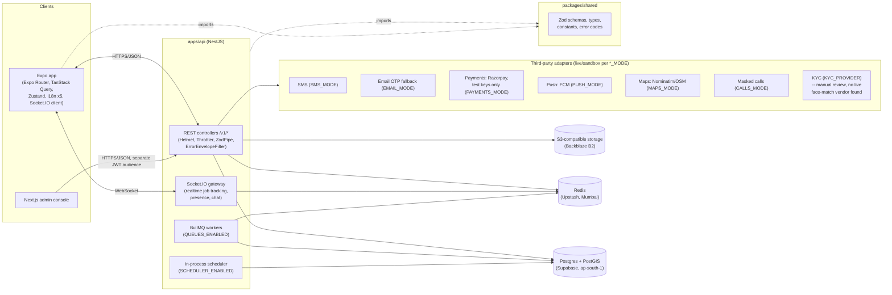

# 03 — Architecture and Stack

> Source: `package.json` files (versions), `docker-compose.yml` (local infra), `docs/RUNBOOK.md`
> (hosting — read in full for the "Current hosting layout" and "Stack" sections),
> `docs/ARCHITECTURE.md`, `.github/workflows/ci.yml`, `apps/api/src/config/env.ts`, and this
> session's own direct observation of the live Render service's environment variables.

## Monorepo layout

pnpm workspace (`pnpm-workspace.yaml`): `apps/*` and `packages/*`.

| Path | Purpose |
|---|---|
| `apps/api` | NestJS REST API + Socket.IO (realtime) + BullMQ (background jobs), Prisma ORM |
| `apps/mobile` | Expo/React Native app (Android; iOS not built/shipped) |
| `apps/admin` | Next.js admin console (KYC review, disputes, config, price list) |
| `packages/shared` | Zod schemas, TypeScript types, constants, error codes — compiled to `dist/` (CJS) and consumed by both `apps/api` and `apps/mobile` as `@haggler/shared`. Must be rebuilt (`pnpm build:shared`) after any change before the other two typecheck against it. |

## Full stack, with versions (from each `package.json`)

| Layer | Technology | Version |
|---|---|---|
| API framework | NestJS | `@nestjs/core` ^11.2.6 |
| API language | TypeScript | ~5.7.2 |
| ORM | Prisma | ^6 (`@prisma/client` ^6) |
| Validation | Zod | ^3, shared across API and mobile via `packages/shared` |
| Realtime | Socket.IO | ^4.8.4 |
| Queues | BullMQ | ^6.3.9, gated by `QUEUES_ENABLED` (default `true`) |
| Redis client | ioredis | ^6.0.0 |
| Mobile framework | Expo | ~57.0.25 |
| Mobile router | expo-router | ~57.0.23 |
| Mobile runtime | React Native | 0.86.3 / React 19.2.3 |
| Mobile data fetching | TanStack Query | ^5.104.0 |
| Mobile state (local prefs) | Zustand | ^5.0.15 |
| Admin framework | Next.js | ^16.3.6 / React 19.2.3 |
| Database engine | PostgreSQL + PostGIS | 16 + PostGIS 3.4 locally (`docker-compose.yml`); Supabase-managed in production, exact minor version UNKNOWN (not read from the live project this session) |
| Database (production) | Supabase (hosted Postgres) | — |
| Cache / rate-limit store / queue backend | Redis | 7 locally (`docker-compose.yml`); Upstash (hosted, TLS `rediss://`) in production |
| Object storage | S3-compatible | MinIO locally (`bitnamilegacy/minio:2025.7.23`); Backblaze B2 in production |
| Maps | `MAPS_MODE` adapter — Nominatim (OpenStreetMap) sandbox adapter confirmed in code (`NOMINATIM_URL`, `NOMINATIM_USER_AGENT` env vars); live adapter identity UNKNOWN beyond that |
| Payments | `PAYMENTS_MODE` adapter — Razorpay, **sandbox/test keys only accepted** (`rzp_test_...`), live keys hard-refused at boot (D-020) |
| Notifications (push) | `PUSH_MODE` adapter — Firebase Cloud Messaging (`FCM_SERVICE_ACCOUNT_JSON`) is the live adapter target; direct-to-FCM, not Expo's push relay (D-051) |
| Auth | Custom OTP (phone, with email fallback) + JWT access tokens + opaque rotating refresh tokens; separate admin JWT audience | — |

## Architecture diagram

Real-time use: Socket.IO carries live job tracking (location pings), presence (a Ranger's
online/offline state), and chat between the matched customer and Ranger. REST remains the source
of truth for every state transition; sockets are a push channel layered on top, not a separate
state store (`apps/api/src/realtime/`).

## Deployment

**Reconciliation note**: `docs/RUNBOOK.md:381` states "Render redeploys automatically on a push
to `main` (configure this in the Render dashboard's...)" — **this session observed that was not
actually configured** on the live `haggler-f` service; every deploy this session required
manually clicking "Deploy" in the Render dashboard after a `git push`. The RUNBOOK's instruction
to configure it may never have been completed, or may have been turned off since. Treat auto-
deploy as **not currently active** until verified in the dashboard.

| Service | Provider | Region | Plan / free-tier limit | Evidence |
|---|---|---|---|---|
| API hosting | Render, service name `haggler-f` | Singapore | Free web service — **spins down after 15 min idle, ~30-60s cold start** on next request; single instance (`WEB_CONCURRENCY=1` implied by `THROTTLE_STORE=memory` default) | `docs/RUNBOOK.md:227,238,283`; this session's screenshot of the Render dashboard (4 services total: `Haggler-f` Deployed/Singapore, `Haggler-admin` Deployed/Virginia, `Haggler` Deployed/Virginia — believed retired per user, `squad-io-backend` Suspended — unrelated project) |
| Database | Supabase (hosted Postgres+PostGIS) | Mumbai (`ap-south-1`) | Free tier — 500 MB storage, **auto-pauses after 7 days with zero activity** (manual "restore" click needed) | `docs/RUNBOOK.md:280`; this session read the live `DATABASE_URL` directly: `aws-0-ap-south-1.pooler.supabase.com:5432`, session pooler (not transaction pooler, deliberately — see RUNBOOK:260-268 for why) |
| Cache / rate-limit / queues | Upstash Redis | Mumbai | Free tier — 500K commands/mo, 256 MB, TLS `rediss://` | `docs/RUNBOOK.md:281,239` |
| Object storage | Backblaze B2 | UNKNOWN region (bucket-level, not re-verified this session) | Free tier — 10 GB | `docs/RUNBOOK.md:282` |
| Mobile build | EAS Build (Expo) | Expo's build infra | Free tier — **15 Android builds/month** | `docs/RUNBOOK.md:284`; this session's own build used `eas-cli` via `npx` (not a project-local `eas` binary — the first invocation attempt, `npx eas ...`, failed with "could not determine executable to run" and had to be retried as `npx eas-cli ...`) |
| Admin console hosting | Render, service name `Haggler-admin` (Virginia, shown "Deployed" in this session's dashboard screenshot) | Virginia | UNKNOWN plan | Not otherwise documented in the repo; existence confirmed only by this session's dashboard screenshot, not by any file in this repo |

**Monthly cost today**: effectively **$0** — every piece above is on a free tier by design,
per `docs/RUNBOOK.md`'s own stated rationale ("free, zero-maintenance host" for Render; no-card
signup was a deciding factor for Backblaze B2 over Cloudflare R2).

**Likely cost at launch scale**: **not derivable from this repository** — no load-testing results,
traffic projections, or a pricing/capacity-planning document exist in this repo to extrapolate
from. As a rough, non-repo-sourced order of magnitude from each provider's publicly listed paid
tiers (Render Starter web service, Supabase Pro, Upstash pay-as-you-go, Backblaze B2 paid usage),
a small-scale production launch commonly runs in the **low tens of US dollars per month** before
traffic-driven overages — but this is a general industry estimate, not a number computed from
anything in this codebase, and should be re-priced directly against each provider's current
pricing page before relying on it.

## CI/CD

Single GitHub Actions workflow, `.github/workflows/ci.yml`, four parallel jobs on every push to
`main` and every PR:

1. **verify** — `pnpm install --frozen-lockfile` → build shared package → `pnpm lint` → `pnpm
   format:check` → `pnpm typecheck` → `pnpm test:unit` → regenerate `docs/openapi.json`/
   `docs/API.md` and fail on any diff (OpenAPI-drift guard) → `pnpm audit --audit-level=high
   --prod` (fails CI on any high/critical dependency advisory).
2. **integration** — API e2e/integration suite against **real Postgres+PostGIS and Redis spun up
   via Testcontainers** (not mocks). This is the suite this session could **not** run locally
   (no Docker daemon available in this environment) — see `08-quality-and-testing.md`.
3. **admin-build** — `pnpm --filter @haggler/admin build` (Next.js production build check).
4. **mobile-bundle** — `expo export --platform android` (bundling check, not a full EAS build).

No separate CD/deploy job exists in this workflow — deployment to Render and the APK build are
both manual steps outside CI, per the Reconciliation note above and `docs/RUNBOOK.md`'s own
step-by-step manual instructions.

## Environment variables, grouped by service (names only — see `apps/api/src/config/env.ts` for
the full zod schema with validation rules; no values reproduced here)

| Group | Variables |
|---|---|
| Core / server | `NODE_ENV`, `PORT`, `PUBLIC_BASE_URL`, `LOG_LEVEL`, `SENTRY_DSN` |
| Database | `DATABASE_URL` |
| Redis / queues / rate-limit | `REDIS_URL`, `QUEUES_ENABLED`, `SCHEDULER_ENABLED`, `THROTTLE_STORE`, `THROTTLE_LIMIT`, `THROTTLE_TTL_SECONDS` |
| Auth (user) | `JWT_ACCESS_SECRET`, `JWT_ACCESS_TTL_SECONDS`, `REFRESH_TTL_DAYS`, `REFRESH_TTL_DAYS_REMEMBER_ME`, `FIELD_ENCRYPTION_KEY`, `TESTING_MODE` |
| Auth (admin) | `ADMIN_JWT_SECRET`, `ADMIN_JWT_TTL_SECONDS` |
| SMS | `SMS_MODE` |
| Email (OTP fallback) | `EMAIL_MODE`, `SMTP_HOST`, `SMTP_PORT`, `SMTP_USER`, `SMTP_PASS`, `SMTP_FROM` |
| Payments | `PAYMENTS_MODE`, `PAYMENTS_SANDBOX_SECRET`, `RAZORPAY_KEY_ID`, `RAZORPAY_KEY_SECRET`, `RAZORPAY_WEBHOOK_SECRET` |
| Push notifications | `PUSH_MODE`, `FCM_SERVICE_ACCOUNT_JSON` |
| Maps | `MAPS_MODE`, `NOMINATIM_URL`, `NOMINATIM_USER_AGENT` |
| Calls (masked) | `CALLS_MODE` |
| KYC | `KYC_PROVIDER` |
| Object storage | `S3_ENDPOINT`, `S3_PUBLIC_ENDPOINT`, `S3_ACCESS_KEY`, `S3_SECRET_KEY`, `S3_REGION`, `S3_FORCE_PATH_STYLE`, `S3_SSE` (names from `docs/RUNBOOK.md`, not independently re-verified against `env.ts` in this pass) |
| Mobile build (EAS) | `EXPO_PUBLIC_API_URL` (set per `eas.json` build profile, e.g. `preview` → `https://haggler-f.onrender.com`) |

## Measured performance numbers found in the repo

From `docs/RUNBOOK.md:241-242` (D-078's Mumbai/Singapore region move, "warm, same moment, both
stacks" comparison):

| Endpoint | Old (Sydney DB + original Render region) | New (Mumbai DB + Singapore Render) |
|---|---|---|
| `GET /health/ready` | ~1.0-1.2s | ~0.3-0.5s |
| `GET /v1/categories` | ~2.1s | ~0.65s |

No other latency, throughput, or load numbers were found anywhere in the repo (no load-testing
scripts, no APM dashboards exported, no benchmark files). `RUNBOOK.md:252-258` separately notes
the **old** Sydney Supabase project showed highly volatile per-query latency (300ms–10s+) and one
observed mid-query connection drop under sustained test load — read as that free-tier instance
degrading under cumulative load, not a code-level cause. No equivalent volatility measurement
exists for the current Mumbai/Singapore pair.
