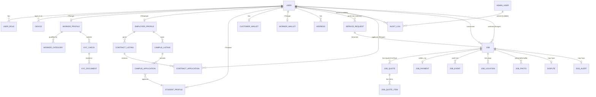

# 04 — Data Model

> Source: `apps/api/prisma/schema.prisma` (read in full, 2035 lines), and the raw-SQL portions of
> `apps/api/prisma/migrations/*/migration.sql` for what Prisma itself cannot model (PostGIS
> geography columns, the audit-log immutability trigger).

## Table count

```
grep -c "^model " apps/api/prisma/schema.prisma
```
→ **65 models**, across **27 migrations** (`ls apps/api/prisma/migrations | grep -v toml | wc -l`).

## Tables grouped by domain

### Identity & auth (7)
`User`, `UserRole`, `Device`, `RefreshToken`, `OtpAttempt`, `Address`, `EmergencyContact`.
`User` is the single account row for every role (phone-based identity; `email` optional,
`dateOfBirthEnc` encrypted). `UserRole` is the join table making roles additive (a `User` can be
`CUSTOMER` + `WORKER` + `EMPLOYER` + `STUDENT` simultaneously). `RefreshToken.tokenHash` is unique
and hashed, never the raw token. `OtpAttempt.codeHash` likewise. `Address.location` is a PostGIS
`geography(Point,4326)` column — `Unsupported` in Prisma's type system, read/written via raw SQL
(`ST_MakePoint`), with a GIST index created in raw migration SQL (Prisma can't express spatial
indexes either).

### Catalog & pricing (6)
`ServiceCategory`, `PriceListEntry`, `PriceListAddOn`, `PriceBand`, `MinimumWageRule`,
`FeatureFlag` (model exists; see `01-overview-and-status.md` — no code path was found reading from
it, flags actually live in `SystemConfig`, see below). `PriceBandScope`/`CityTier` enums scope a
price band to a city tier. `PriceListEntry` is the fixed floor price per category; the ceiling is
computed at runtime by `FeeService.ceilingPaise` (see `02-job-flow-and-money.md`), not stored.

### Admin (3)
`AdminUser`, `AdminRole`, `AuditLog`. `AdminUser.passwordHash` (scrypt, per D-025).
**`AuditLog` rows cannot be updated or deleted at the database level** — a Postgres trigger
(`audit_logs_immutable()` / `audit_logs_no_update_delete`, defined in
`migrations/20260928000001_foundation/migration.sql:325-331`) raises an error on any `UPDATE` or
`DELETE` against the table, enforced below the application layer so even a compromised API process
can't tamper with the trail. `SystemConfig` is where every runtime-tunable value in this report
(fee bps, broadcast radii, flag booleans, etc.) actually lives — a generic `key`/`value` (JSON)
table read by `FeeService`/`MarketplaceConfig`/others with a 15-second in-memory cache.

### KYC & verification (6)
`WorkerProfile`, `WorkerCategory`, `Consent`, `KycCheck`, `KycDocument`, `KycReview`,
`ProfessionalReference`, `CallSession`. `WorkerProfile.aadhaarLast4Enc`/`dateOfBirthEnc` are
encrypted; `identityHash` is a unique hash used for duplicate-identity detection across accounts
(D-093 anti-fraud). `WorkerProfile.lastLocation` is the second PostGIS geography column. `KycCheck`
tracks tier (1/2/3) and status; `KycDocument` stores document *metadata* (type, status,
upload timestamp) — the actual files live in S3-compatible object storage, not the database (see
`03-architecture-and-stack.md`).

### Core on-demand marketplace (14)
`ServiceRequest`, `Job`, `JobMatch`, `RequestBroadcast`, `RequestMedia`, `Offer`, `JobAddOn`,
`JobQuote`, `JobQuoteItem`, `ItemHandover`, `JobEvent`, `JobPhoto`, `JobLocation`, `SosAlert`.
`Job` is the central table — see `02-job-flow-and-money.md` for its full state machine
(`JobStatus`) and the arrival/completion code fields (`arrivalCodeHash`/`arrivalCodeEnc`,
`completionCodeHash`/`completionCodeEnc` — stored both hashed, for verification, and encrypted,
so it can be re-displayed to the Ranger without a second code-generation round trip).
`ServiceRequest.location` and `JobLocation.location` are the third and fourth PostGIS geography
columns (live tracking pings land in `JobLocation`, one row per ping). `JobEvent` is an append-only
audit trail of everything that happened on one job (distinct from the global `AuditLog`, which
covers admin/system actions more broadly).

### Trust & safety (4)
`Dispute`, `IncidentReport`, `FraudReviewItem`, `Block`. `Dispute.resolution` /
`DisputeStatus` drive the `DISPUTED → REFUNDED | CONFIRMED_BY_CUSTOMER` edges in the job state
machine. `FraudReviewItem` is populated by the flag-only fraud signals described in
`02-job-flow-and-money.md` (velocity, repeat-pair, low-value) — it never blocks automatically.

### Chat & safety-sharing (2)
`ChatThread`, `ChatMessage`, `TrustedShare` (trip-sharing with a trusted contact).

### Reputation (3)
`WorkerStats`, `CustomerStats`, `Review`. These back the League system (see
`06-features-by-role.md`).

### Money (9)
`CustomerWallet`, `WalletLedgerEntry`, `WalletHold`, `TokenBundle`, `PaymentOrder`,
`WorkerWallet`, `WorkerWalletLedgerEntry`, `JobPayment`, `PlusPlan`, `PlusMembership`. As covered
in `01-overview-and-status.md`: `CustomerWallet`/`TokenBundle`/their ledger entries are the
token-purchase system whose *UI* was removed this session (D-106) — the tables and their API
endpoints are untouched. `JobPayment` is the per-job payment record (`mode`: CASH/ONLINE,
`status`, `feePaise`, `servicePricePaise`) referenced throughout the settlement logic in
`02-job-flow-and-money.md`. `PlusPlan`/`PlusMembership` back the Haggler Plus subscription, the
one part of the original wallet screen that's still a real, active feature.

### Contracts & Campus (6)
`EmployerProfile`, `ContractListing`, `ContractApplication`, `StudentProfile`, `CampusListing`,
`CampusApplication`. As noted in `02-job-flow-and-money.md`, Campus reuses `ContractListingStatus`/
`ContractApplicationStatus` rather than having its own enums. `StudentProfile.dateOfBirthEnc`
is a **separate, deliberately distinct** encrypted DOB field from `User.dateOfBirthEnc` — per the
code comment at `schema.prisma:1965`, self-declared once and never editable via the general
profile-update path, specifically so a student can't edit their way around an under-18 hard block.
`StudentProfile` also holds the course/year/skills/availability/bio/portfolio fields added this
session (D-103, migration `20261026000000_phase23_student_profile_details`).

## Entity-relationship diagram (main entities)



(65 tables exist in total; this diagram shows the main relationships only, per the task's
request — every table is listed and described by domain group above.)

## Data protection in the schema

| Data | Treatment | Evidence |
|---|---|---|
| `User.dateOfBirthEnc`, `WorkerProfile.dateOfBirthEnc`, `StudentProfile.dateOfBirthEnc` | Encrypted at rest (app-level `EncryptionService`, key from `FIELD_ENCRYPTION_KEY`) | `schema.prisma:92,478,1962` |
| `WorkerProfile.aadhaarLast4Enc` | Encrypted; **only the last 4 digits are ever stored** — the full Aadhaar number is never persisted (per `docs/COMPLIANCE.md`'s own stated rule) | `schema.prisma:477` |
| `WorkerProfile.identityHash` | One-way hash, unique — used to detect the same real person registering multiple accounts, without storing the identifying data itself in queryable form | `schema.prisma:484` |
| `RefreshToken.tokenHash`, `OtpAttempt.codeHash`, `Job.arrivalCodeHash`, `Job.completionCodeHash` | Hashed, never stored raw; the matching `...Enc` sibling columns on `Job` store an **encrypted** (reversible) copy so the code can be redisplayed to the right party without a new code round trip | `schema.prisma:164,186,891-901` |
| `AdminUser.passwordHash` | scrypt with a per-user salt (D-025) | `schema.prisma:327` |
| `AuditLog` | Immutable at the database level via trigger (see above) | `migrations/20260928000001_foundation/migration.sql:325-331` |
| Phone numbers | Stored in plaintext on `User.phone` (needed as the login identifier and for SMS delivery) — not encrypted or hashed. On account purge (D-108's 48h-grace deletion), `phone` is overwritten with a random tombstone value (`+99...`) so the real number is not retained | `apps/api/src/users/account-lifecycle.service.ts` (`purgeOne`) |
| KYC document images / selfies | Not in the database — stored as files in S3-compatible object storage; the DB only holds type/status/timestamp metadata (`KycDocument`) and a presigned-URL reference pattern (`StorageService`) | `apps/api/src/kyc/`, `apps/api/src/adapters/storage/` |
| Live location pings | Stored per-job in `JobLocation` (PostGIS geography points), not retained on the `User`/`WorkerProfile` row beyond the single `lastLocation` snapshot — no evidence of a long-term location-history table | `schema.prisma:1208`, `492-493` |
